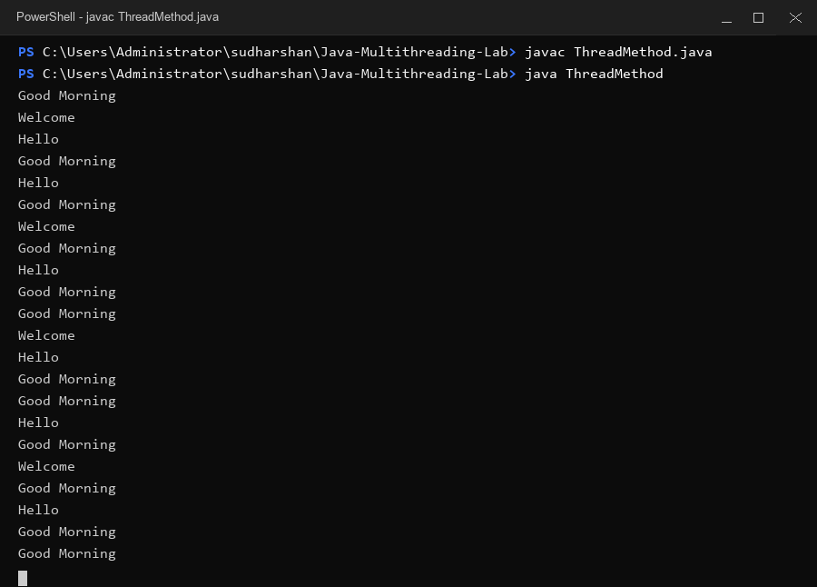
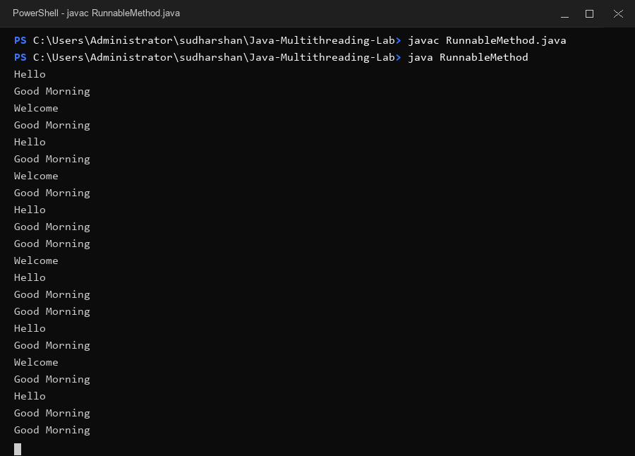

# Java Multithreading Lab

### Problem Statement

The objective of this lab assignment is to write Java programs that create and execute three concurrent threads to display messages at specified time intervals:

1. **Good Morning Thread** — displays `Good Morning` every 1 second (1000 milliseconds).
2. **Hello Thread** — displays `Hello` every 2 seconds (2000 milliseconds).
3. **Welcome Thread** — displays `Welcome` every 3 seconds (3000 milliseconds).

The lab requires implementing the solution using two fundamental Java multithreading techniques:
* **Method 1:** Extending the `Thread` class.
* **Method 2:** Implementing the `Runnable` interface.

---

### Method 1 — Extending Thread

In `ThreadMethod.java`, multithreading is achieved by subclassing the `java.lang.Thread` class:

* `GoodMorningThread extends Thread`: Overrides `run()` to print `"Good Morning"` and sleep for `1000` ms.
* `HelloThread extends Thread`: Overrides `run()` to print `"Hello"` and sleep for `2000` ms.
* `WelcomeThread extends Thread`: Overrides `run()` to print `"Welcome"` and sleep for `3000` ms.

The `main` method of `ThreadMethod` instantiates each thread class and invokes their `.start()` methods to initiate concurrent execution.

---

### Method 2 — Implementing Runnable

In `RunnableMethod.java`, multithreading is achieved by implementing the `java.lang.Runnable` interface:

* `GoodMorning implements Runnable`: Overrides `run()` to print `"Good Morning"` and sleep for `1000` ms using `Thread.sleep(1000)`.
* `Hello implements Runnable`: Overrides `run()` to print `"Hello"` and sleep for `2000` ms using `Thread.sleep(2000)`.
* `Welcome implements Runnable`: Overrides `run()` to print `"Welcome"` and sleep for `3000` ms using `Thread.sleep(3000)`.

The `main` method of `RunnableMethod` creates `Runnable` target instances, wraps them inside `Thread` objects (`new Thread(runnable)`), and starts them using `.start()`.

---

### Execution

To compile and execute Method 1:

```bash
javac ThreadMethod.java
java ThreadMethod
```

To compile and execute Method 2:

```bash
javac RunnableMethod.java
java RunnableMethod
```

---

### Time Intervals

| Thread              | Message      | Interval  |
| ------------------- | ------------ | --------- |
| Good Morning Thread | Good Morning | 1 second  |
| Hello Thread        | Hello        | 2 seconds |
| Welcome Thread      | Welcome      | 3 seconds |

---

### Output

Because threads execute concurrently and asynchronously, the exact sequence of output messages may vary between runs depending on operating system thread scheduling.

Below are the terminal execution screenshots demonstrating the compilation and continuous execution of both methods:

#### Method 1 Execution Screenshot (`ThreadMethod.java`)


#### Method 2 Execution Screenshot (`RunnableMethod.java`)

